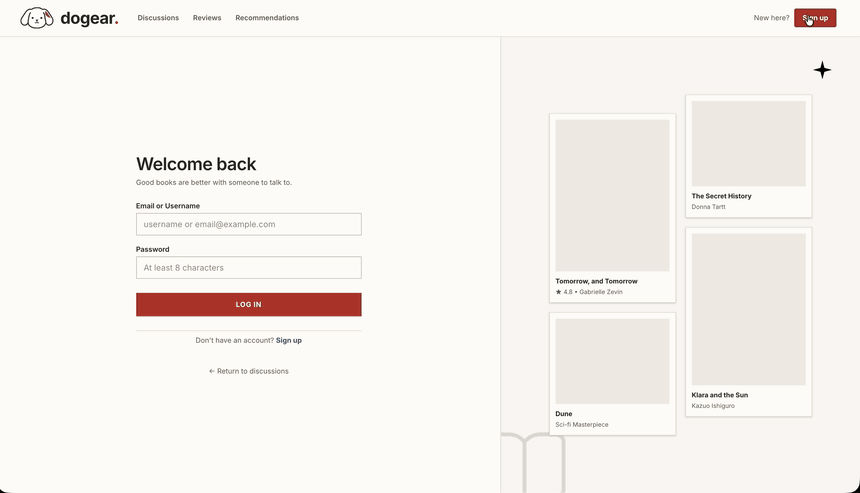

<p align="center">
  
</p>

# Dogear

**A place to talk about the books you read.**

Dogear is a book discussion forum where readers share reviews, ask questions, and find their next read through recommendations from other readers. Start a conversation about a book you just finished, share an opinion, or join an existing thread to hear what others thought.

Built as a CodePath WEB102 final project.

[Features](#features) · [Walkthrough](#walkthrough) · [Tech stack](#tech-stack) · [Getting started](#getting-started) · [Known limitations](#known-limitations)

## Features

- **Start a book discussion.** Publish a post with a title, optional text, and an optional book cover or image URL. Organize it as a Review, Question, Recommendation, or Opinion.
- **Join the conversation.** Add comments, reply to other readers, and follow threaded discussions. Delete your own comments when needed.
- **Find something to read or discuss.** Search discussion titles, browse by category, and sort by newest or most upvoted. Browse additional posts with pagination.
- **Upvote interesting posts.** Show appreciation for a review, recommendation, or question and help other readers find it.
- **Manage your posts.** Edit or delete discussions you created. Only the author can make those changes.
- **Create a reader account.** Sign up with an email, password, and a chosen or generated username. Browse discussions without an account; sign in to post, comment, reply, or upvote.
- **Return to your discussions.** Posts, comments, and upvotes are saved in Supabase and remain available after closing the app. Account settings also let you change your password.

Search, category, sort, and page selections stay in the URL, so you can share a filtered feed or return to it using browser navigation.

## Walkthrough

<p align="center">
  
</p>

## Tech stack

| Purpose | Technology |
| --- | --- |
| Application | React 19, React Router 8 |
| Development and build | Vite 8 |
| Accounts and database | Supabase Auth, PostgreSQL |
| Styling and icons | Tailwind CSS 4, Lucide React |
| Linting | oxlint |

React handles the pages and forms. Supabase manages authentication and stores public profiles, posts, and comments. Database ownership policies restrict who can edit or delete content, and a database function increments upvotes without losing simultaneous updates.

Replies are saved with a parent reference and assembled into threads when a discussion loads.

## Getting started

### 1. Install the project

```bash
git clone https://github.com/anushacodes/codepath-final-project.git
cd codepath-final-project
npm install
```

### 2. Connect Supabase

Create a Supabase project. If you do not already have a `.env.local` file, copy the example:

```bash
cp .env.example .env.local
```

Fill in your project URL and publishable key:

```env
VITE_SUPABASE_URL=https://your-project-ref.supabase.co
VITE_SUPABASE_PUBLISHABLE_KEY=your-publishable-key
```

Use the public publishable key, never a secret or service-role key. `.env.local` is excluded from Git.

For a new database, run [`supabase/migrations/0001_schema.sql`](supabase/migrations/0001_schema.sql) in the Supabase SQL Editor. It creates the tables, ownership policies, signup profile trigger, and upvote function. Keep this file in the project; restarting the app does not require running it again.

### 3. Run locally

```bash
npm run dev
```

Open the local URL printed in the terminal, usually `http://localhost:5173`.

### 4. Check and build

```bash
npm run lint
npm run build
```

`npm run preview` serves the production build locally. `vercel.json` includes route rewrites for hosting the app on Vercel.

## Known limitations

- **Username changes need database permissions.** The account page includes a username form, but the included schema does not grant profile updates. The form can show a local change that does not persist in the shared profile table.
- **Use email when signing in on another device.** Username sign-in depends on a browser-saved mapping or a built-in demo account mapping.
- **Upvotes are repeatable.** The app does not enforce one vote per reader.
- **Comments load together.** Comment pagination and automatic updates from other readers are not implemented; reload a discussion to fetch their latest comments.
- **Replies share the comment length limit.** Their parent reference counts toward the database's 2,000-character limit.
- **Offline preview is limited.** Without Supabase credentials, demo posts and sign-in use browser storage, but comments require Supabase.
- **Unsubmitted text is not saved.** Reloading or closing a page can discard a draft.

The walkthrough recording and production deployment are still pending.
